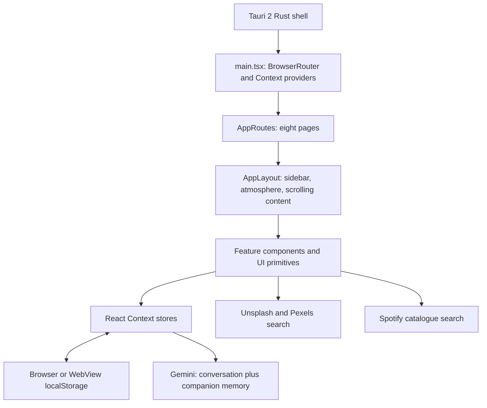

# Flâneur

A premium, lo-fi self-care and personal-use application designed for women: a quiet space for moodboards, daily routines, journaling, wellness, inspiration, music discovery and a personal AI companion.

This repository contains the current **0.1.0** iteration: a React application that runs in a browser and has a Tauri 2 desktop shell. Some integrations and cards are incomplete. Source publication does not imply a production deployment, verified native release or completed mobile app.

## Features and pages

| Page | Route | Implemented behavior | Current limits |
| --- | --- | --- | --- |
| Home | `/` | Greetings, daily quote, mood/environment, task/habit summaries, selected music and active moodboard widgets | Sample initial content; greeting helpers mix local time and Asia/Kolkata |
| Moodboard Studio | `/moodboard` | Create/select/rename/delete boards, image upload/drop, view/delete images, Unsplash/Pexels search and save | Collection pills do not filter; AI Generate has no handler; initial grid shows 20 images and window-scroll pagination may not follow the scrolling main panel |
| Music Studio | `/music` | Sample playlist controls, progress/seeking, favorites/recent selections, Spotify catalogue search | Player is a timer/visual simulation with no audio engine; search results do not become playable tracks; Connect Spotify has no handler; recommendations, artist and collections are static |
| Inspiration Studio | `/inspiration` | Add/delete quotes, ideas, song references, books and movies | Manual collections with sample defaults; no book/movie recommendation API |
| Daily Companion | `/daily` | Editable focus, tasks, habit creation/deletion/completion, morning/evening routine lists, hydration and completion percentage | Streak is a saved/sample value; no automatic daily reset, streak calculation, notification or scheduler |
| Wellness Hub | `/wellness` | Mood history, journal creation/deletion, saved reflections/gratitude, cycle inputs, activity counts, heatmap and count-based score | Weekly Insights is static; heatmap shows recent logs rather than calendar days; cycle phases use fixed ranges without automatic rollover; score is an activity heuristic, not a health assessment |
| AI Companion | `/companion` | Gemini chat, persisted history, clear chat, typing animation, personality selection/keyword switching, phrase-based memory and local activity summary | Full response arrives before character animation; errors use canned fallback replies; full history is sent each time; no provider selector or context-size management |
| Settings | `/settings` | Name/bio, stored motion/particle preferences, five atmosphere selections | Theme is fixed to night; animation components currently do not consume the stored motion/particle flags |

Atmospheres include Night City, Rain Room, Forest, Beach and Midnight Café, with animated particles and overlays. Ambient audio is not implemented.

Existing scaffolding and unused files are retained, including the OpenRouter adapter, memory editor, alternate inspiration/image cards, legacy moodboard data and theme card. `BoardPickerModal.tsx`, `TaskCard.tsx`, `DailyStatsCard.tsx` and `CompanionMemoryPanel.tsx` are empty placeholders.

## Architecture



- `src/main.tsx` mounts StrictMode, BrowserRouter, environment/theme providers and feature providers. State/actions live in `src/store`, using `useState` and `useEffect` persistence. Home widgets read the same stores as feature pages.
- `src/routes/AppRoutes.tsx` maps the eight pages into `src/layouts/AppLayout`. `src/components` contains feature UI and reusable primitives.
- Images are remote URLs or uploaded data URLs. Uploaded images, personal entries, settings and chat history live in local storage, not repository files.
- AI calls originate in `companionStore.tsx`, use `utils/buildCompanionContext.ts` for prompts and call `services/gemini.ts`. `utils/companionContext.ts` separately reads activity data for the UI summary. Activity-summary data is not automatically the same as prompt memory. Phrase extraction writes directly to storage, so the memory Context can lag updates.
- `src/services` uses direct browser `fetch`. `aiMessageService.ts` reads local greeting/quote/reflection data; it does not call an LLM. `openRouter.ts` has no active caller.
- `src-tauri/src/lib.rs` initializes Tauri/opener and registers the template `greet` command, which the frontend does not call. There is no application backend, database server, account system, OAuth callback, worker, cloud sync or migration/seed service.
- Tauri grants core/opener defaults to the main window. Its existing configuration has `csp: null`; this iteration has not been hardened as a public production distribution.

### Folder map

```text
src/
  components/
    Sidebar/          Navigation and sidebar items
    ambient/          Animated atmosphere overlays
    companion/        Chat, personalities and memory UI
    daily/            Tasks, routines, habits, focus and hydration
    environments/     Environment selection components
    home/             Dashboard widgets
    inspiration/      Quote, idea, book, movie and music cards
    layout/           Retained alternate navigation definition
    moodboard/        Boards, uploads, search, grid and modal
    music/            Simulated player and Spotify search UI
    settings/         Profile, motion and atmosphere controls
    ui/               Shared inputs, buttons, cards and transitions
    wellness/         Mood, journal, reflection, gratitude and cycle UI
  data/               Local greetings, quotes and reflection prompts
  environments/       Atmosphere types, configuration and provider
  hooks/              Greeting and quote hooks
  layouts/            Shared application layout
  pages/              Eight route entry components
  routes/             Route definitions
  services/           Gemini, OpenRouter, Spotify, Unsplash, Pexels
  store/              Context stores, companion memory and sample data
  styles/             Global styles and Google Fonts import
  themes/             Night theme and styling constants
  utils/              Greetings, memory extraction and context helpers
src-tauri/
  capabilities/       Window permissions
  icons/              Bundle icons
  src/                Rust entry points
  Cargo.toml          Native dependencies
  Cargo.lock          Locked Rust dependencies
  tauri.conf.json     Dev URL, frontend build and bundle settings
public/               Existing Vite/Tauri SVG assets
.env.example          Blank integration-variable template
package.json          Development/build commands
package-lock.json     Locked JavaScript dependencies
vite.config.ts        React/Tailwind plugins; strict port 5173
```

### Technology

React 19, React Router 7, TypeScript 5.8 with strict checking, Vite 7, Tailwind CSS 4, Framer Motion and Lucide React. Inter and Playfair Display load through Google Fonts. Native code uses Tauri 2, Rust 2021 edition, the opener plugin, Serde and Serde JSON. Browser APIs include localStorage, FileReader, fetch and `crypto.randomUUID`. No Redux, SQL database, ORM or server-side framework is configured.

The manifests contain compatible version ranges; committed lockfiles select exact versions. Use `npm ci`, not an unrelated dependency upgrade.

## Prerequisites

1. Install Git and Node.js with npm. **Node 24 LTS** is recommended; publication checks used Node 24.20.0/npm 11.19.0. [Vite 7 requires Node 20.19+ or 22.12+](https://vite.dev/blog/announcing-vite7) on those release lines; prefer a supported LTS.
2. Use a modern browser with local storage enabled. Use localhost or HTTPS for secure-context APIs.
3. Internet is needed for dependency downloads, remote fonts/images and enabled APIs. Local tools need no third-party credentials after installation.

Desktop/mobile development also requires the platform tooling below. No Docker, database or migration command is required.

## Install and run

```sh
git clone https://github.com/CRYO-MANCER/Flaneur.git
cd Flaneur
npm ci
```

Create your private environment file once. In PowerShell:

```powershell
Copy-Item .env.example .env
```

On macOS/Linux:

```sh
cp .env.example .env
```

Do not overwrite an existing `.env`. Leave credentials blank to start with local features. Fill only integrations you intend to use, then:

```sh
npm run dev
```

Open **http://localhost:5173**. Port 5173 is strict; resolve a conflicting process before starting. Restart Vite after changing `.env`. If PowerShell blocks `npm.ps1`, use `npm.cmd` with the same arguments.

### Environment variables

All names referenced by source are in `.env.example` with empty values. None is required merely to render the local app.

| Variable | Adapter | Needed for |
| --- | --- | --- |
| `VITE_GEMINI_API_KEY` | `services/gemini.ts` | Live AI Companion replies from `gemini-2.5-flash` |
| `VITE_SPOTIFY_CLIENT_ID` | `services/spotify.ts` | Spotify catalogue search |
| `VITE_SPOTIFY_CLIENT_SECRET` | `services/spotify.ts` | Current Spotify client-credentials token request |
| `VITE_UNSPLASH_KEY` | `services/unsplash.ts` | Unsplash Access Key for image search, not its Secret Key |
| `VITE_PEXELS_KEY` | `services/pexels.ts` | Pexels image search |
| `VITE_OPENROUTER_API_KEY` | `services/openRouter.ts` | Retained unused adapter; optional for current UI |

**Credential boundary:** Vite exposes `VITE_*` values to frontend code and embeds referenced values in builds. Ignoring `.env` protects Git history, not browser/WebView requests or compiled assets. Preserve this iteration for private local use with your own credentials; do not share credential-bearing builds or deploy them publicly. Spotify client credentials belong on a trusted server; private LLM keys also need a protected boundary before public distribution. That backend/authentication change is not implemented here. See [Vite environment variables](https://vite.dev/guide/env-and-mode) and [Google key-security guidance](https://ai.google.dev/gemini-api/docs/api-key).

## Third-party setup

Dashboard labels, eligibility, quotas and pricing can change. Check the linked official documentation. Credentials/accounts are not supplied by this repository.

### Gemini: active AI provider

1. Sign into [Google AI Studio](https://aistudio.google.com/) with your Google account.
2. Create/select an eligible project and create a Gemini API key using [Google's guide](https://ai.google.dev/gemini-api/docs/api-key). Ensure the project/key can access the Generative Language API.
3. Set `VITE_GEMINI_API_KEY` in your private `.env` and restart Vite.
4. Open AI Companion and send a non-sensitive test message. The adapter calls v1beta `generateContent` with the hardcoded `gemini-2.5-flash` model.
5. Check quota, model access and billing if requests fail. [Gemini pricing](https://ai.google.dev/gemini-api/docs/pricing) lists free and paid tiers; eligibility/limits vary and paid use requires billing. A consumer Gemini subscription does not supply this API key.

Chat sends conversation history and stored companion-memory fields to Google. The UI activity summary is separate and is not automatically merged into prompt memory. Provider privacy/data-use terms apply. A canned fallback reply does not prove a live request succeeded.

### Spotify: catalogue search, not account login

1. Sign into the [Spotify Developer Dashboard](https://developer.spotify.com/dashboard). Review [development-mode eligibility](https://developer.spotify.com/documentation/web-api/concepts/quota-modes): Spotify currently requires Premium for development-mode app owners and imposes limits. Do not assume a new free account is sufficient.
2. Create an app with its name/description and website, select Web API where requested and accept the terms. See [Spotify app setup](https://developer.spotify.com/documentation/web-api/concepts/apps).
3. Open app settings and copy Client ID/Client Secret to `VITE_SPOTIFY_CLIENT_ID` / `VITE_SPOTIFY_CLIENT_SECRET` in your local `.env`.
4. **Redirects:** the implemented client-credentials flow has no browser redirect, callback route, scopes, user-consent screen or refresh-token storage. If registration requires a redirect URI, an allowed local example is `http://127.0.0.1:5173`; registering it does not implement login. Spotify disallows `localhost` as a redirect URI and requires HTTPS except for explicit loopback IPs. See [redirect rules](https://developer.spotify.com/documentation/web-api/concepts/redirect_uri).
5. Restart Vite and use Search Spotify in Music Studio. The service POSTs `grant_type=client_credentials` to the token endpoint, then searches tracks with its bearer token. Results are catalogue metadata, not user playlists/history. See [client-credentials authentication](https://developer.spotify.com/documentation/web-api/tutorials/client-credentials-flow).

The secret is sent from the frontend in this iteration; this is not a secure public Spotify client. User login, PKCE/callback handling, synchronization and Web Playback SDK support remain future work. There is no redirect environment variable. Connect Spotify does not authenticate. Premium does not add missing playback/sync functionality to the code.

### Unsplash: moodboard image search

1. Create an [Unsplash developer account](https://unsplash.com/developers) and register a new application in the apps dashboard.
2. Review its terms/guidelines. Copy the **Access Key** into `VITE_UNSPLASH_KEY`; do not use or publish the Secret Key.
3. Restart Vite and search from Moodboard Studio. The adapter calls `/search/photos` with `Client-ID` authorization and up to 20 results; saving stores an image URL in the active board.
4. Demo access has limited quota and production approval is separate. An Unsplash+ subscription does not configure the API. See [Unsplash documentation](https://unsplash.com/documentation).

The current cards retain source/title/image data. Photographer attribution and download tracking required by Unsplash's API guidelines are not fully implemented; review them before public API distribution.

### Pexels: additional moodboard image search

1. Create a Pexels account and [request an API key](https://www.pexels.com/api/).
2. Set `VITE_PEXELS_KEY`, restart Vite and use the same Moodboard Studio search.
3. The adapter calls `/v1/search` with an Authorization header and up to 20 photos, combining results with Unsplash. Failed searches may show empty results rather than explicit errors.
4. API access is free subject to limits/terms. Higher limits, approval and attribution are provider-controlled. See [Pexels documentation](https://www.pexels.com/api/documentation/).

### OpenRouter: retained, inactive adapter

1. If developing against this adapter, create an [OpenRouter account](https://openrouter.ai/) and an API key in its key settings.
2. Set `VITE_OPENROUTER_API_KEY` locally. The adapter targets `/api/v1/chat/completions` with `google/gemini-2.5-flash`.
3. Check model availability and arrange API credits/billing where needed; do not assume this model is a free route. See [setup](https://openrouter.ai/docs/quickstart) and [billing FAQ](https://openrouter.ai/docs/faq).

No current page/store calls this adapter. Adding the key does not switch AI Companion from Gemini; using it requires a future integration change. The current app does not require an OpenAI/ChatGPT API account.

### Other resources

Google Fonts supplies Inter and Playfair Display through CSS without a key/subscription. Retained inspiration defaults also reference Unsplash CDN images. `PinterestSearch` actually calls Unsplash and Pexels; there is no Pinterest API. No payments, analytics, email, hosting or subscription-management service is configured.

## Commands and builds

| Command | Purpose |
| --- | --- |
| `npm ci` | Install exact locked JavaScript dependencies |
| `npm run dev` | Start Vite on strict port 5173 |
| `npm exec tsc -- --noEmit` | Check app TypeScript |
| `npm exec tsc -- --noEmit --project tsconfig.node.json` | Check Vite configuration TypeScript |
| `npm run build` | Check app TypeScript and build to `dist/` |
| `npm run preview` | Serve built frontend locally |
| `npm run tauri -- info` | Inspect native tooling |
| `npm run tauri -- dev` | Start desktop shell and Vite |
| `npm run tauri -- build` | Build native bundles for the supported host |

`dist/`, `node_modules/` and Rust `target/` are generated and ignored. Native compilation can occupy several gigabytes locally; it is excluded from the source push. Keep both dependency lockfiles committed.

For credential-free output, build a clean checkout without a filled `.env`, or blank all credentials before building. Frontend hosting needs an SPA fallback to `index.html` for BrowserRouter routes. Repository publication does not configure GitHub Pages, a base path, hosting, CI or a backend; current assets assume a root path.

## Tauri desktop setup

Follow [Tauri prerequisites](https://v2.tauri.app/start/prerequisites/) for the target OS:

1. Install stable Rust with rustup. Verify `rustc --version` and `cargo --version` in the terminal used for npm.
2. Install native prerequisites. Windows needs Microsoft C++ Build Tools with Desktop development with C++, Windows SDK and WebView2. macOS desktop needs Xcode Command Line Tools. Linux needs its distribution-specific WebKitGTK 4.1, compiler and supporting libraries from the guide.
3. Run `npm ci` at the root and configure any private local credentials.
4. Run `npm run tauri -- info`, then `npm run tauri -- dev`. Tauri starts Vite through `beforeDevCommand`; do not start another copy on 5173.
5. Run `cargo check --locked --manifest-path src-tauri/Cargo.toml` for native compilation validation. There are no authored Rust unit tests.
6. Use `npm run tauri -- build` on the appropriate host. It runs the frontend build and packages `dist/`; bundles normally appear in `src-tauri/target/release/bundle/`.

The window starts at 800×600; bundle targets are `all` and the identifier is `com.flaneur.app`. Existing template metadata/icons are retained. Cross-platform installers, signing, notarization, updater behavior and store distribution are not verified/configured as a release pipeline. Keep signing material outside Git and do not distribute credential-bearing builds.

## Tauri mobile setup: scaffold only

Rust has Tauri's mobile entry annotation, but generated Android/iOS projects are absent. Native generation, device networking, layout adaptation and testing remain manual work. These are next setup steps, not verified mobile support. See [Tauri development](https://v2.tauri.app/develop/) and [mobile prerequisites](https://v2.tauri.app/start/prerequisites/#mobile-development).

### Android

1. Complete Rust prerequisites. Install Android Studio, its bundled JDK, SDK Platform, Platform-Tools, Build-Tools, Command-line Tools and NDK (Side by side).
2. Set `JAVA_HOME`, `ANDROID_HOME`, `NDK_HOME` to installed locations, accept SDK licenses and reopen the terminal. These are machine variables, not `VITE_*` credentials.
3. Add Rust targets:

   ```sh
   rustup target add aarch64-linux-android armv7-linux-androideabi i686-linux-android x86_64-linux-android
   ```

4. At the root, run `npm run tauri -- android init` to generate the native project.
5. With an emulator/configured device, run `npm run tauri -- android dev`. Use `npm run tauri -- android build` for a native build.

On a physical device, localhost refers to the device. Current Vite config does not handle `TAURI_DEV_HOST` or device-reachable HMR. Follow [Tauri's Vite configuration guide](https://v2.tauri.app/start/frontend/vite/) and deliberately configure networking before expecting device development to work. Do not expose credentials to untrusted networks. Google Play publication also needs signing, a developer account and store preparation.

### iOS

1. Use macOS with full Xcode, iOS SDK/simulator and Tauri's required tooling, including CocoaPods where applicable.
2. Add Rust targets:

   ```sh
   rustup target add aarch64-apple-ios x86_64-apple-ios aarch64-apple-ios-sim
   ```

3. Run `npm run tauri -- ios init`, configure your signing team in generated Xcode settings, then `npm run tauri -- ios dev` or `npm run tauri -- ios build`.
4. Device/App Store distribution needs Apple signing/developer-account arrangements. iOS cannot be built in this Windows environment.

## Local data and privacy

- Journals, cycle inputs, moods, chats, memories, uploaded image data and preferences remain in the current browser/WebView local storage. The app does not encrypt, synchronize or back up these entries.
- Different origins/ports, browser profiles and native WebViews use different storage. Cloning source does not copy personal entries.
- Large data URLs can exhaust storage. Some JSON is parsed without recovery, so malformed entries can prevent rendering. Back up personal data before repairing a specific entry; do not clear all storage as the first troubleshooting step.
- `.gitignore` excludes `.env*` except `.env.example`, credential/certificate formats, local databases, backups and generated output. Do not add browser-profile exports, private screenshots or personal-data exports.

## Validation

Checks below were run on **2026-10-23**, on Windows with Node 24.20.0/npm 11.19.0, using a fresh temporary source copy without the private `.env` or existing `node_modules`/Rust output.

| Check | Result |
| --- | --- |
| Fresh `npm ci` using the committed lockfile | Passed |
| `npm run dev` | Started successfully on port 5173 |
| Application `tsc --noEmit` | Passed after the three compilation repairs below |
| Vite-config `tsc --noEmit --project tsconfig.node.json` | Passed |
| `npm run build` | Passed; Vite emitted the production frontend |
| Browser smoke check of the production build | All eight pages rendered; a new task's completion, journal entry and board persisted after reload; no browser console errors observed |
| Intended source and credential-free build scan | No matches for local credential values/encoded values or the checked common credential patterns; generated/sensitive file exclusions checked |
| `npm audit` | Reports 9 existing dependency vulnerabilities: 1 low, 2 moderate, 6 high; this is an outstanding check, not a clean security audit |
| `npm run tauri -- info` | Reports WebView2 present, but Rust/Cargo/rustup and MSVC/SDK build tooling unavailable; native compilation/packaging blocked in this environment |
| Live Gemini/Spotify/Unsplash/Pexels requests | Not exercised; require the developer's credentials, quotas and service access |
| Android/iOS builds and device use | Not verified; generated native projects/toolchains are not supplied |

No JavaScript test/lint scripts or automated test suite are configured. The browser check is a smoke check, not comprehensive E2E/accessibility coverage. Reported dependency findings affect baseline-browser-mapping, browserslist, esbuild, nanoid, postcss, react-router, react-router-dom, source-map-js and vite. No bulk dependency upgrade was applied during publication; evaluate advisories and compatible updates separately before public deployment. Native build success and external API operation are not implied by a passing frontend build.

The initial full-tree Git whitespace check also reported four pre-existing warnings (three trailing spaces and a blank line at EOF). Those unrelated files were preserved; the changed publication files pass the whitespace check.

Publication required three narrow compilation repairs: the retained `UserImages` component reads active-board images; the retained theme card handles the declared night-only mode; stored chat memory is typed as partial before merging defaults. Strict compiler settings and existing features are preserved.

## Troubleshooting

| Symptom | Check |
| --- | --- |
| PowerShell blocks `npm.ps1` | Use `npm.cmd` with the same arguments |
| Install fails/dependencies differ | Use documented Node and `npm ci`; check registry/network access and preserve lockfiles |
| Port 5173 occupied | Identify the conflicting server; Tauri already starts Vite |
| Changed key has no effect | Restart Vite, check exact names and network status; never share credential headers |
| Gemini gives generic replies | Check model/key/quota/billing response; fallback text is canned |
| Spotify 401/403/429 or empty results | Check app credentials, Premium/development eligibility and quota; error UI is limited |
| Connect Spotify / Generate Moodboard does nothing | Buttons are placeholders, not configuration problems |
| Image search empty | Check both providers' credentials/quota/network responses; errors may become empty results |
| Uploaded image fails to persist | Check image size/storage quota; preserve personal entries before repair |
| Theme/motion controls seem ineffective | Night theme is fixed and motion flags are not wired to animations |
| `cargo`/`rustc` missing | Install Rust or fix PATH and reopen terminal; old `target/` files do not prove current tooling is available |
| Native build fails | Check `tauri info`, OS dependencies, Rust and web build separately |
| Phone cannot reach app | Complete mobile init/toolchain/device networking; mobile is unverified |
| Hosted route refresh gives 404 | Configure SPA fallback; no deployment is included |
| Fonts/images unavailable offline | These resources use external hosts; local uploads are separate |

## Branches

- `main`: current publication baseline, subject to the verification limits above.
- `dev`: starts at the same commit for future development.

Only these two branches are part of initial publication. Develop on `dev` and promote reviewed, validated changes to `main`. Keep credentials, generated builds and personal data out of both.
